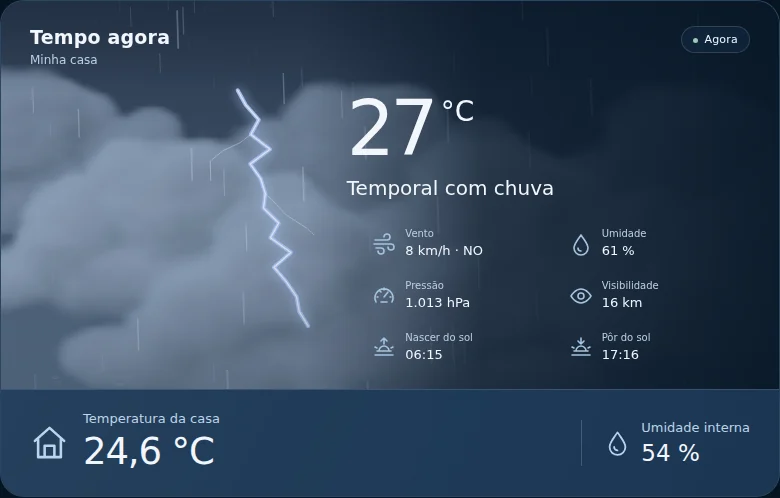
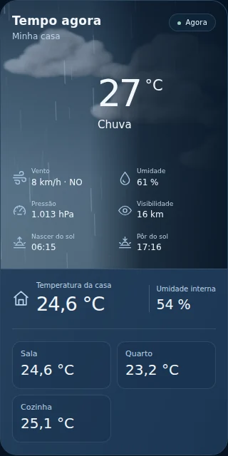

**Animated Weather Card for Home Assistant.** Clima atual em cima, temperatura da casa embaixo, com animações naturais e transições suaves.

[English installation guide](docs/INSTALL.en.md) · [Atualizar do Tempo Vivo](docs/MIGRATION.md) · [Versões e downloads](https://github.com/Douglaslopes24/Tempo-vivo/releases) · [Suporte](SUPPORT.md)




## O que o Ceuvia oferece

- Sol, lua com crateras, estrelas, nuvens com volume e sombras, chuva com profundidade e respingos, raios ramificados, neve, granizo, neblina, vento e distorção do ar no calor.
- As nuvens chegam antes da chuva começar. A chuva para antes de o céu abrir. Atualizações de temperatura preservam o movimento.
- Temperatura e umidade da casa, com sensores opcionais por cômodo. Usa as entidades que você já tem no Home Assistant.
- Editor visual com sensores, português e inglês, tema, qualidade da animação e duração da transição.
- Cadastro automático do módulo em painéis gerenciados pela interface. Compatibilidade com os cartões e sensores das versões Tempo Vivo.
- Funciona com uma entidade `weather` diretamente ou com o sensor agregado da integração. O card não carrega scripts, imagens ou serviços de análise externos.

[Veja a animação](docs/animacao-realista.mp4) ou baixe [demo.html](demo.html) e abra no navegador. A demonstração usa o código de produção e dados de exemplo; os botões permitem testar cada clima.

## Instalar pelo HACS

Requer **Home Assistant 2024.8 ou posterior** e navegador moderno. Este repositório é instalado como **Integração** no HACS.

1. Abra **HACS → Repositórios personalizados** e adicione `https://github.com/Douglaslopes24/Tempo-vivo`, categoria **Integração**.
2. Baixe **Ceuvia Weather Card** e reinicie o Home Assistant.
3. Em **Configurações → Dispositivos e serviços → Adicionar integração**, procure **Ceuvia Weather Card**. Selecione a entidade de clima e os sensores desejados.
4. Recarregue o navegador. Em **Editar painel → Adicionar cartão**, procure **Ceuvia Weather Card** e configure pelo editor visual.

Novas instalações usam este YAML mínimo:

```yaml
type: custom:ceuvia-weather-card
entity: weather.forecast_casa
```

Selecione a temperatura da casa no editor, ou acrescente seu sensor:

```yaml
type: custom:ceuvia-weather-card
entity: weather.forecast_casa
indoor_temperature: sensor.temperatura_da_casa
indoor_humidity: sensor.umidade_da_casa
```

Os IDs acima são exemplos. Use os IDs reais de suas entidades.

## Atualizar uma instalação existente

No HACS, use **Atualizar** ou **Baixar novamente**, selecione **3.0.0**, reinicie o Home Assistant e recarregue o painel com **Ctrl+F5**. O nome muda para Ceuvia Weather Card.

O `type: custom:tempo-vivo-card` antigo continua funcionando. A atualização preserva os IDs dos sensores e migra seu próprio recurso para a nova URL. Veja o [guia de migração](docs/MIGRATION.md).

## Sensores e personalização

| Opção | Função | Padrão |
| --- | --- | --- |
| `entity` | Entidade `weather` ou sensor agregado Ceuvia | Obrigatória |
| `title`, `location` | Título e local | Texto do idioma e nome da entidade |
| `language` | `auto`, `pt-BR`, `en` | Idioma do Home Assistant |
| `theme` | `auto`, `dark`, `light` | `auto` |
| `indoor_temperature`, `indoor_humidity` | Sensores internos | Seleção da integração |
| `outdoor_temperature`, `outdoor_humidity` | Sensores externos alternativos | Dados da entidade `weather` |
| `wind`, `pressure`, `visibility`, `feels_like` | Medidas meteorológicas alternativas | Dados da entidade `weather` |
| `sun_entity` | Entidade solar | `sun.sun` |
| `sunrise`, `sunset` | Sensores de horários alternativos | `sun.sun` |
| `rain_sensor` | Sensor binário; `on` ativa chuva | Opcional |
| `storm_alert` | Sensor binário; `on` ativa temporal | Opcional |
| `heat_alert` | Sensor binário de alerta de onda de calor | Opcional |
| `heat_threshold` | Limite de calor em °C; `false` desativa | `35` |
| `animation` | Movimento ativo | `true` |
| `animation_quality` | `low`, `balanced`, `high` | `balanced` |
| `transition_duration` | Mudança de clima em segundos, entre 2 e 12 | `4.5` |
| `rooms` | Sensores ou entidades `climate` por cômodo | Opcional |
| `weather_entity` | Origem meteorológica explícita com agregado | Seleção da integração |

Temperaturas são convertidas para a unidade do painel. O limite numérico mostra **Calor intenso**. **Onda de calor** aparece quando o sensor de alerta configurado fica `on`. Chuva, temporal e neve têm prioridade visual sobre o calor. O card acompanha os estados do Home Assistant e não prevê sozinho o início da chuva.

```yaml
type: custom:ceuvia-weather-card
entity: weather.forecast_casa
title: Tempo agora
location: Minha casa
indoor_temperature: sensor.temperatura_da_casa
indoor_humidity: sensor.umidade_da_casa
language: pt-BR
theme: auto
animation: true
animation_quality: balanced
transition_duration: 4.5
heat_threshold: 35
rooms:
  - name: Sala
    entity: sensor.temperatura_sala
  - name: Quarto
    entity: sensor.temperatura_quarto
    humidity_entity: sensor.umidade_quarto
```

Também há um [exemplo comentado](docs/examples.yaml).

**Equilibrada** usa até 30 quadros por segundo. **Detalhada** aumenta as camadas, gotas e resolução e permite até 60. **Leve** reduz a resolução, camadas e gotas e usa até 24; a distorção do calor é desativada nesse modo. O desempenho depende do aparelho. A animação pausa fora da tela e segue a preferência de movimento reduzido.



## Instalação manual

Baixe o ZIP da [versão 3.0.0](https://github.com/Douglaslopes24/Tempo-vivo/releases/tag/v3.0.0), extraia e copie a pasta `custom_components` para a configuração do Home Assistant. Reinicie e adicione a integração. A pasta interna continua `tempo_vivo` para preservar atualizações.

Para usar somente o card, baixe o arquivo `ceuvia-weather-card.js` da versão, copie para `www` e cadastre `/local/ceuvia-weather-card.js?v=3.0.0` como **Módulo JavaScript**. Use uma entidade `weather` e os sensores diretamente no YAML ou no editor.

## Se o cartão não aparecer

1. Confirme que a integração foi **adicionada em Dispositivos e serviços**, além de baixada no HACS.
2. Em **Configurações → Painéis → menu ⋮ → Recursos**, confira a URL `/ceuvia/ceuvia-weather-card.js?v=3.0.0`, tipo **Módulo JavaScript**. Ative o **Modo avançado** no perfil se a opção não aparecer.
3. Se faltar, adicione esse recurso. Recarregue o navegador com Ctrl+F5.
4. Se abrir essa URL no mesmo endereço do Home Assistant resultar em **404**, confira a instalação e os registros de `custom_components.tempo_vivo`.

Em painéis com recursos gerenciados por YAML, acrescente este item à lista existente em `lovelace.resources`:

```yaml
- url: /ceuvia/ceuvia-weather-card.js?v=3.0.0
  type: module
```

Mantenha o modo de painel e os recursos que já usa. Trocar o ID da entidade não resolve o erro de componente JavaScript ausente.

## Distribuição e validação

Cada versão publicada contém um ZIP de instalação, o JavaScript independente, a demonstração e `SHA256SUMS.txt`. Os pacotes são gerados automaticamente depois da validação.

CI executa Hassfest, testes de configuração e migração de recursos, navegador real e um teste de instalação em Home Assistant 2024.8 isolado. A verificação inclui registro do módulo, aliases antigos, editor, idiomas, sensores, transições, tratamento de indisponibilidade e dimensões de celular. Os relatórios ficam em [docs](docs/); os dados são de teste e não representam uma instalação particular.

Para desenvolvimento e repetição dos testes, leia [CONTRIBUTING.md](CONTRIBUTING.md). Para erros e ideias, use os [formulários de suporte](https://github.com/Douglaslopes24/Tempo-vivo/issues/new/choose).

## Licença e créditos

MIT. Ceuvia é a continuação do Tempo Vivo. As cenas, ícones e componentes são próprios. Foram consultadas a estrutura de [Clock Weather Card](https://github.com/pkissling/clock-weather-card), [Dynamic Weather Card](https://github.com/teuchezh/dynamic-weather-card) e a documentação de cartões personalizados do Home Assistant.
